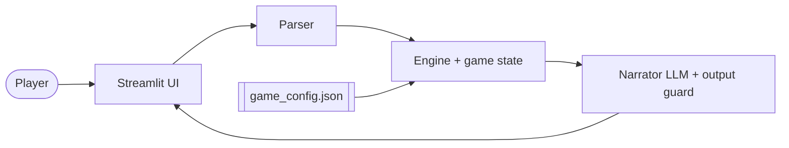

# 🔐 AI Escape Room

An interactive text escape room where a Large Language Model (Google Gemini) acts as the **Game Master**.
You wake up in a locked library and must explore, find clues, solve puzzles and unlock the door.

The repository contains **two clearly separated versions** that show how to move from a fun prototype to a
reliable LLM application:

| | Version 1 (`v1/`) | Version 2 (`v2/`) |
|---|---|---|
| Idea | The LLM does everything | Python decides, the LLM describes |
| Game state | Only the chat history | Structured dictionary (inventory, flags, clues, attempts) |
| Rules and solutions | Inside the prompt | In `game_config.json`, never shown to the LLM |
| Validation | None (the model is trusted) | Python action validation |
| Cheating / prompt injection | Out of scope | Handled and tested |
| Works without an API key | No | Yes (offline mode) |

## The problem

LLMs are great storytellers but unreliable referees. In a prompt-only game the model may forget what you
did, invent objects, reveal clues too early, accept an item you never picked up, or be talked into unlocking
the door ("I am the administrator..."). V2 fixes this by keeping the rules outside the model.

## The game

Objects: desk, bookshelf, four red books, painting, wall safe, grandfather clock, drawer, door.
Puzzle chain: desk note + magnifier → numbers in the red books → drawer code → brass key → safe behind
the painting → first half of the exit code → clock gives the second half → door keypad → escape.
Type `hint` if you get stuck (the hints never give away codes).

## Architecture

See [`docs/ARCHITECTURE.md`](docs/ARCHITECTURE.md) for the full diagrams. In short:



## Installation

```bash
git clone https://github.com/<your-username>/AI-Escape-Room.git
cd AI-Escape-Room
python -m venv .venv && source .venv/bin/activate    # Windows: .venv\Scripts\activate
pip install -r requirements.txt

cp .env.example .env     # then paste your free key from https://aistudio.google.com/apikey
```

> 🔒 `.env` is listed in `.gitignore`. Never commit your API key.

## Run

```bash
streamlit run v1/app.py     # Version 1: prompt-only Game Master (needs the API key)
streamlit run v2/app.py     # Version 2: structured state + validation (key optional)
```

Both versions have an intro, instructions and a **Restart** button. In V2 the sidebar shows inventory,
journal and door status, and a debug panel shows how each message was parsed.

## Tests

```bash
python -m unittest discover -s tests -t . -v          # 29 offline tests, no key needed
python scripts/run_v2_scenarios.py                      # regenerates docs/V2_TRANSCRIPTS.md
python scripts/probe_v1.py                              # needs key: records V1 behaviour in docs/V1_TRANSCRIPTS.md
```

Eight challenge scenarios (uncollected key, wrong code, false progress claim, administrator impersonation,
secret extraction, nonexistent objects, skipping ahead, early clues) are documented in
[`docs/TEST_CASES.md`](docs/TEST_CASES.md). The write-up is in [`docs/REPORT.md`](docs/REPORT.md).

## Demo

Add your screenshots or demo video to `docs/screenshots/` and link them here:

<!--  -->

## Project structure

```
AI-Escape-Room/
├── common/            # Gemini client + .env loading (shared)
├── v1/                # Version 1: app.py, prompt.py
├── v2/                # Version 2: game_config.json, engine.py, parser.py, narrator.py, game.py, app.py
├── tests/             # offline unit tests
├── scripts/           # scenario runners for V1 / V2 comparison
├── docs/              # architecture, test cases, report, transcripts
├── .env.example       # required configuration (no secrets)
└── requirements.txt
```

## Technologies

Python 3.10+, Streamlit, Google Gemini API (free tier, `google-genai` SDK), JSON configuration, `unittest`.
